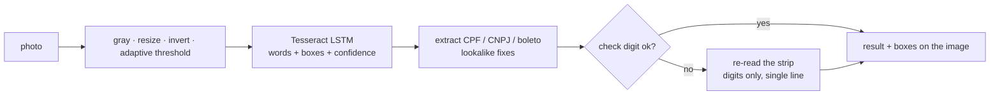

# ocr-brasil


OCR for Brazilian documents that runs entirely in the browser. Take a photo of a boleto, an
invoice or a CNPJ card, and it finds the CPF, the CNPJ (alphanumeric too) and the boleto line,
checks every digit and decodes the boleto (bank, amount, due date). The image never leaves the
device, and the server only hosts static files.

> 🇧🇷 OCR de documentos brasileiros no navegador: acha CPF, CNPJ (inclusive o alfanumérico) e
> linha digitável de boleto numa foto, confere os dígitos verificadores e decodifica o boleto.
> A imagem não sai do aparelho.

Live demo: [vgmelo.tech/demos/ocr](https://vgmelo.tech/demos/ocr/)

## Why

Generic OCR gets most characters right, and with documents that isn't good enough: one wrong
digit in a boleto pays someone else. Brazilian documents carry their own error detection (mod 11
for CPF/CNPJ, mod 10 and mod 11 for boletos), so this project uses the check digit as the signal
for what to trust:

- **Lookalikes are fixed only when the check digit agrees.** OCR reads `0` as `O`, `1` as `l`,
  `5` as `S`. A letter is turned into a digit only if the result validates, and every change is
  reported with its position.
- **Re-read on failure.** When a finding fails the check, the reader crops just that strip of the
  image and reads it again as a single line of digits. It replaces the first read only if the
  second one validates.
- **Says what is wrong.** An invalid boleto points at the field whose digit doesn't match. An
  invalid CPF or CNPJ shows the digits the rule expects.
- **Clean-up built for phone photos.** Grayscale, resize to the size Tesseract reads best,
  inversion of light-on-dark text, and a Bradley-Roth adaptive threshold (integral image, O(n))
  so a shadow over half the page doesn't wipe the text.
- **Self-hosted model.** Tesseract.js (WASM) with the Portuguese LSTM model (`por`, 1.3 MB) served
  from your own origin. No CDN and no blob: worker, so it runs under a strict CSP that only adds
  `'wasm-unsafe-eval'`.



## What it checks

| Document | Rule |
|---|---|
| CPF | two mod 11 digits |
| CNPJ | two mod 11 digits, letters worth `ord(c) - 48` (IN RFB 2.229/2024) |
| Boleto bancário (47 digits) | mod 10 per field, mod 11 general digit, bank, amount, due date |
| Arrecadação (48 digits) | mod 10 or mod 11 per block (by the 3rd digit), segment, amount |

The due-date factor wrapped from 9999 back to 1000 on 2025-02-22, so every factor maps to two
dates 25 years apart; the one closer to today wins.

The CPF/CNPJ rule is the same as in [mcp-server-brasil](https://github.com/vicgamelo/mcp-server-brasil),
with the same test cases (and 6,000 random cases cross-checked against it). The boleto rules are
cross-checked against [boleto-utils](https://github.com/edniemeyer/boleto-utils) on random codes.
That comparison also turned up two gaps in boleto-utils: it skips the general digit on a linha, and
it drops leading amount digits when the second one is 0.

## Usage

```ts
import { createReader, prepare } from 'ocr-brasil';

const reader = await createReader({
  workerPath: '/ocr/worker.min.js',
  corePath: '/ocr/core/',
  langPath: '/ocr/lang/',
});

const { data, width, height } = ctx.getImageData(0, 0, w, h);
const { image } = prepare(data, width, height, { binarize: true });
const result = await reader.read(canvasFrom(image)); // any Tesseract.js ImageLike
// result.findings: [{ type: 'BOLETO', valid: true, boleto: { amountCents, dueDate, bank, fields... } }, ...]
```

Without OCR, the extractor works on any text:

```ts
import { extractDocuments } from 'ocr-brasil';

extractDocuments('CNPJ 11.222.333/OOO1-8l');
// [{ type: 'CNPJ', valid: true, doc: { formatted: '11.222.333/0001-81' }, corrections: [O→0, O→0, O→0, l→1] }]
```

## Development

```bash
npm install
npm test            # unit tests + real Tesseract on fixtures/ (Node, ~2 s)
npm run typecheck
npm run fixtures    # regenerate fixtures/ (Python via uv; all numbers fictitious)
```

`fixtures/` holds five rendered samples (a boleto, the same boleto as a poor phone photo, an invoice
photo with a shadow, an electricity bill and a dark CNPJ card). The integration test runs the
same pipeline as the demo on each one and expects every document to come out valid, with no
extra ones. Two more tests show why each step exists: the adaptive threshold reads the shadowed corner
of the invoice (plain grayscale loses it), and without the re-read the boleto photo fails its
check digit.

## License

MIT. Tesseract.js, tesseract.js-core and the `por` traineddata are Apache 2.0.
